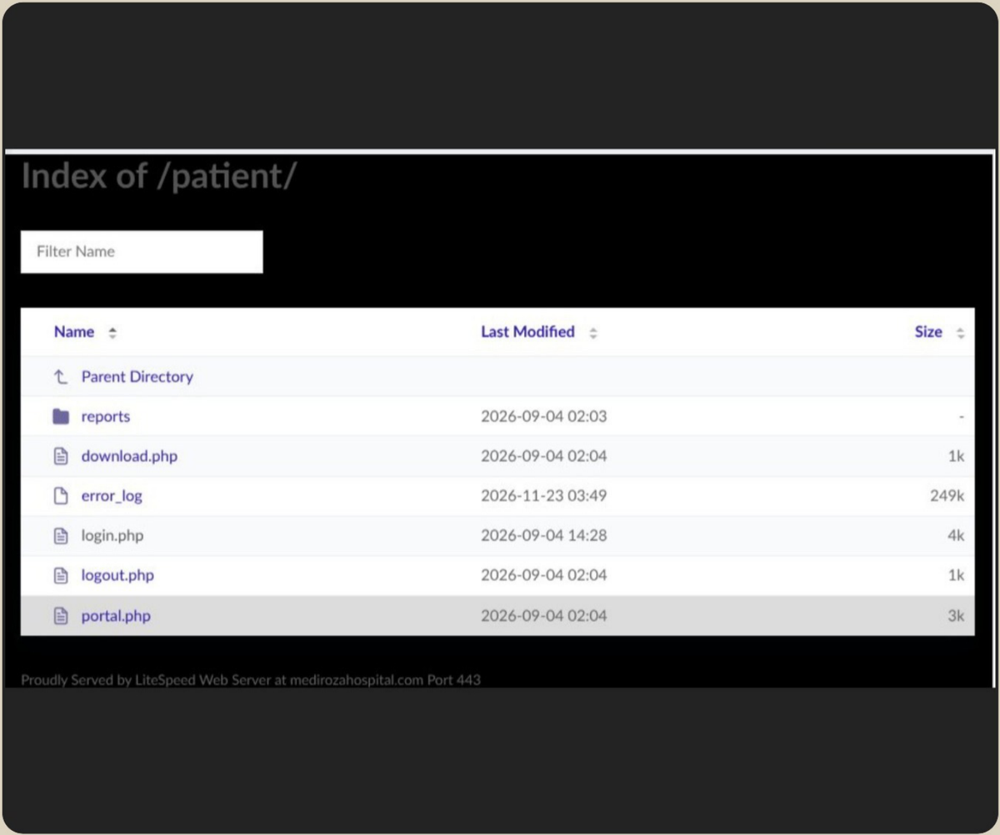
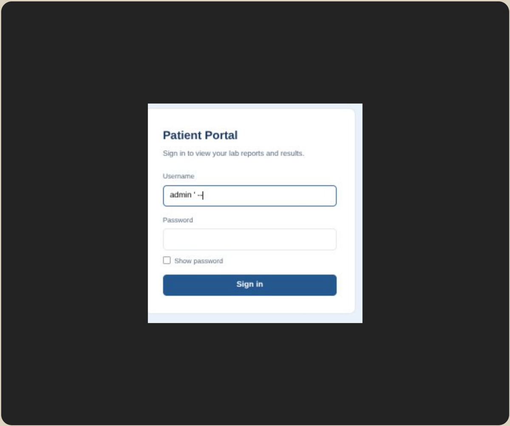
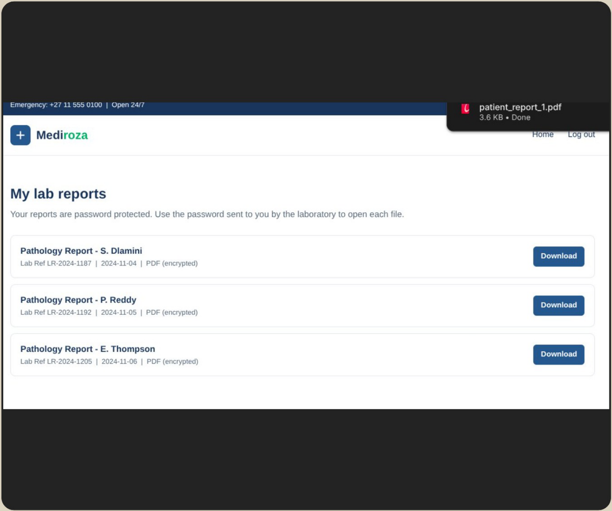
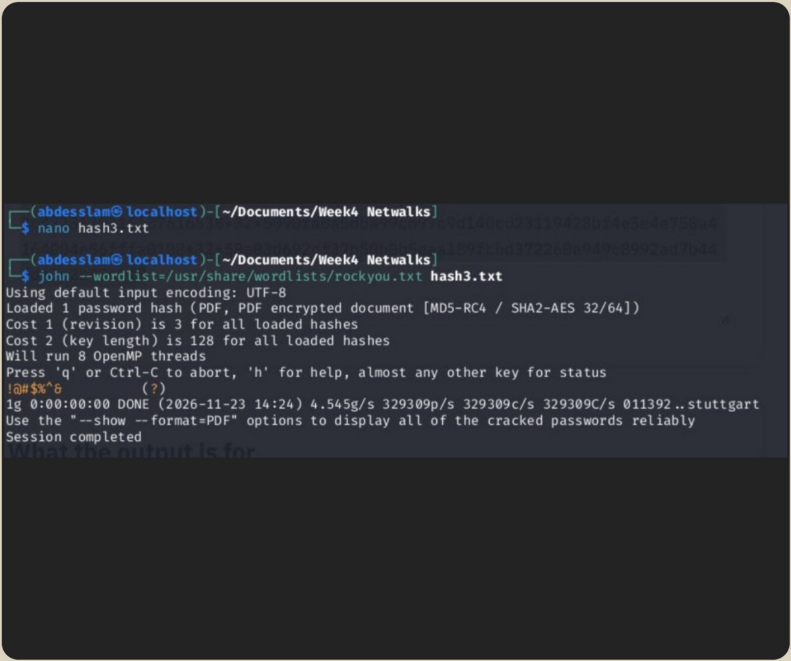
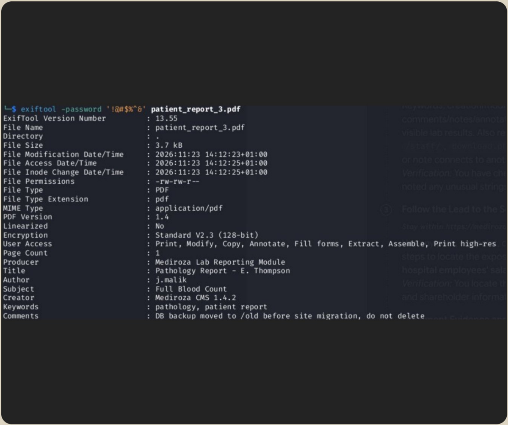

# Mediroza General Hospital — Penetration Testing Report

[](#risk-rating)
[](#scope--methodology)
[](#recommendations--remediation)

A black-box, external, unauthenticated penetration test of `medirozahospital.com`'s patient and staff portals, conducted under written client authorization against synthetic/test data.

> **Disclaimer:** This engagement was performed under a signed authorization agreement against synthetic/test data prepared for the exercise. No real patient, employee, or shareholder data was accessed. This repository documents the findings for portfolio/educational purposes; sensitive evidence (raw data dumps) has been summarized rather than reproduced — see [Responsible Disclosure Notes](#responsible-disclosure-notes).

---

## Table of Contents

- [Executive Summary](#executive-summary)
- [Scope & Methodology](#scope--methodology)
- [Attack Chain](#attack-chain)
- [Findings](#findings)
  - [F1 — Directory Listing Enabled](#f1--directory-listing-enabled-on-sensitive-paths-low)
  - [F2 — SQL Injection / Authentication Bypass](#f2--sql-injection-in-patient-login-authentication-bypass-critical)
  - [F3 — Unauthorized Access to Patient Lab Reports](#f3--unauthorized-access-to-patient-lab-reports-high)
  - [F4 — Weak PDF Encryption / Weak Passwords](#f4--weak-pdf-encryption--weak-passwords-on-patient-records-high)
  - [F5 — Sensitive Data in PDF Metadata](#f5--sensitive-data-and-infrastructure-notes-in-pdf-metadata-medium)
  - [F6 — Exposed Legacy Backup (HR + Shareholder Data)](#f6--exposed-legacy-backup-containing-hr-and-shareholder-data-critical)
- [Risk Rating](#risk-rating)
- [Recommendations & Remediation](#recommendations--remediation)
- [Responsible Disclosure Notes](#responsible-disclosure-notes)

---

## Executive Summary

This engagement assessed the external web presence of Mediroza General Hospital's patient and staff portals (`medirozahospital.com`) for exploitable security weaknesses. Testing was performed over a 3-day window (22–24 November 2026) against synthetic/test data prepared for this exercise, under written client authorization.

The assessment identified a **chain of vulnerabilities** that, together, allowed an unauthenticated external party to:

1. Bypass patient authentication,
2. Access a backend file-retrieval function,
3. Recover the contents of password-protected patient lab reports, and
4. Ultimately locate an exposed historical database backup containing internal HR and shareholder records.

**Overall risk to the client: `CRITICAL`.** The combination of an authentication-bypass vulnerability and an exposed backup directory represents a realistic path to a significant data breach affecting patient confidentiality, staff personal data, and corporate information.

---

## Scope & Methodology

| | |
|---|---|
| **Target** | `https://medirozahospital.com` |
| **Test type** | Black-box, external, unauthenticated |
| **Timeline** | 22–24 November 2026 (3 days) |
| **Authorization** | Written client authorization; test data only |
| **Rules of engagement** | Testing limited to the target domain; no social engineering; no denial-of-service; no testing outside agreed scope |

**Approach:**

1. **Reconnaissance** — enumerated exposed directories and endpoints to map the application's attack surface (patient/staff portals, directory listings).
2. **Authentication testing** — assessed the patient login mechanism for input-handling weaknesses.
3. **Post-authentication review** — examined file-retrieval functionality reachable after bypassing login.
4. **File and metadata analysis** — analyzed retrieved documents for encryption strength and embedded metadata.
5. **Credential/password recovery** — attempted offline recovery of document passwords using standard dictionary-based tooling.
6. **Follow-up on metadata leads** — metadata embedded in a recovered file referenced a legacy path, which was checked for continued exposure.

**Tooling:** `curl` (web requests), `ExifTool` (file metadata inspection), `John the Ripper` + a common wordlist (offline password recovery), manual testing of the authentication form.

**Limitations:** the engagement window was limited to 3 days; testing was restricted to the stated scope and did not include infrastructure outside the web application.

---

## Attack Chain

The engagement progressed through three milestones, each building on the access or information obtained in the previous one:

```
 M1                         M2                          M3
Auth Bypass  ─────────▶  Credential Recovery  ─────▶  Data Exposure
(F2, F3)                  (F3, F4)                     (F5, F6)

SQLi in login form        Weak per-document            Metadata in a
→ admin session with      PDF passwords cracked        recovered PDF
  no valid credentials    offline in seconds with      pointed to a
→ "My lab reports"        John the Ripper + rockyou     legacy backup path
  download function         → 3 patient PDFs opened     still live on the
  reachable, 3 patient                                   public web root
  PDFs retrieved                                        → full DB export
                                                           (staff + shareholder
                                                            data) downloaded
```

| Milestone | Related Findings | Summary |
|---|---|---|
| **M1 — Initial Access: Authentication Bypass** | F2, F3 | A crafted value in the username field (`admin' --`) bypassed the login check entirely, granting an administrative-level session with no valid credentials. From that session, patient lab reports were reachable. |
| **M2 — Credential Recovery: Weak Document Protection** | F3, F4 | The retrieved PDF lab reports were protected with weak, dictionary-crackable passwords. All three were recovered offline within minutes. |
| **M3 — Sensitive Data Exposure: Legacy Backup** | F5, F6 | Metadata in a recovered PDF referenced a legacy backup path. That path was still publicly reachable and contained a full database export with staff salary and shareholder data. |

---

## Findings

### F1 — Directory Listing Enabled on Sensitive Paths `LOW`

Directory listing was enabled on application subdirectories (e.g. `/staff/`, `/patient/`), exposing internal file names such as `login.php`, `download.php`, `portal.php`, and a server error log. This handed an attacker a map of the application's internal structure before any authentication step, lowering the effort required for further attacks.


*Evidence: directory index for `/patient/`, publicly browsable with no authentication.*

---

### F2 — SQL Injection in Patient Login (Authentication Bypass) `CRITICAL`

The patient portal login form did not properly validate or sanitize user-supplied input before using it in a backend database query. Submitting a crafted value in the username field allowed the login check to be bypassed entirely, granting access to the portal as an administrative-level user without knowing any valid credentials. Classic SQL Injection (**OWASP A03:2021 – Injection**) leading to full authentication bypass.


*Evidence: login form submitted with `admin' --` in the username field, bypassing the credential check.*

---

### F3 — Unauthorized Access to Patient Lab Reports `HIGH`

Once authenticated via the F2 bypass, the attacker reached a "My lab reports" download function and retrieved all three patients' password-protected PDF lab reports — despite not being the legitimate owner of that session. The download function does not independently verify that the requesting user is authorized to access each specific file (**Broken Access Control, OWASP A01:2021**).


*Evidence: the post-bypass session's "My lab reports" view, with a report download in progress.*

---

### F4 — Weak PDF Encryption / Weak Passwords on Patient Records `HIGH`

The three retrieved PDF files were protected with standard PDF password encryption (RC4/AES, 128-bit). All three passwords were recoverable offline within minutes using a common password-cracking tool and a publicly available wordlist, indicating weak, guessable, or dictionary-based passwords were used to "protect" highly sensitive patient health data. This defeats the intended confidentiality control entirely.


*Evidence: `john --wordlist=rockyou.txt hash3.txt` recovering the document password almost instantly.*

---

### F5 — Sensitive Data and Infrastructure Notes in PDF Metadata `MEDIUM`

Metadata embedded in the recovered PDF files (inspected via a standard metadata tool) included internal authorship/system details and, in one file, an operational comment left by hospital staff referencing a legacy backup location that was "not deleted" ahead of a prior site migration. This is an information-disclosure issue — internal notes should not be embedded in documents distributed to patients.


*Evidence: `exiftool` output showing the `Comments` field — the pivot point that led to F6.*

---

### F6 — Exposed Legacy Backup Containing HR and Shareholder Data `CRITICAL`

Following the lead from F5, a legacy path on the same web server was found still publicly reachable and contained a full database export left over from a prior site migration. The export included internal records such as hospital staff salary information and company shareholder details — data with no legitimate reason to be reachable from the public internet. This is a Critical exposure (**OWASP A05:2021 – Security Misconfiguration / Sensitive Data Exposure**).

> **Note:** consistent with the original report's own data-handling guidance ("contents summarized, not reproduced"), the raw database-dump screenshot for this finding is **not included** in this repository, since it contains detailed personal and financial fields (names, emails, phone numbers, salaries, national IDs). See [Responsible Disclosure Notes](#responsible-disclosure-notes).

---

## Risk Rating

| ID | Finding | Risk | Justification |
|---|---|---|---|
| F2 | SQL injection — authentication bypass | `CRITICAL` | Unauthenticated, full bypass of patient login; root cause enabling F3 and downstream access |
| F6 | Exposed legacy backup (HR + shareholder data) | `CRITICAL` | Full database export of sensitive internal data, publicly reachable with no authentication |
| F3 | Unauthorized access to patient lab reports | `HIGH` | Direct exposure of protected health information (PHI) to an unauthorized party |
| F4 | Weak PDF encryption/passwords on patient records | `HIGH` | Confidentiality control for PHI defeated in minutes with common tooling |
| F5 | Sensitive data/notes in PDF metadata | `MEDIUM` | Information disclosure that provided the pivot to F6, but required a second step to exploit |
| F1 | Directory listing enabled | `LOW` | Information disclosure only; aids reconnaissance but does not itself grant access |

---

## Recommendations & Remediation

| ID | Recommendation |
|---|---|
| **F1** | Disable directory listing on the web server; ensure all directories return a 403 or custom error page instead of an index. |
| **F2** | Use parameterized queries / prepared statements (or a vetted ORM) for all database access; never concatenate user input into SQL. Add server-side input validation and a web application firewall as defense-in-depth. Conduct a full code review of all other input points for the same pattern. |
| **F3** | Enforce access control checks on every file-retrieval request, verifying the authenticated session owns the specific record requested (not just that a session exists). Apply the principle of least privilege by role. |
| **F4** | Replace standard PDF password protection with strong, randomly generated, per-document passwords (or move to encrypted delivery via the authenticated portal only, without a static password). Enforce a minimum password strength policy for any document-level encryption. |
| **F5** | Strip internal metadata, comments, and authoring notes from any document generated for external/patient distribution. Establish a document-sanitization step in the lab reporting pipeline. |
| **F6** | Immediately remove the legacy/backup path from the public web root; move backups to storage with no public web exposure. Review all migration-related artifacts for similar leftover exposures. Rotate any credentials or sensitive values contained in the exposed export. |
| **General** | Conduct regular black-box and authenticated penetration tests; implement a web application firewall; adopt a secure SDLC with security code review prior to deployment; establish a vulnerability disclosure/patch management process. |

---

## Responsible Disclosure Notes

- All testing in this engagement was performed **under written client authorization** and against **synthetic/test data** prepared specifically for this exercise — no real patients, staff, or shareholders were involved.
- This repository is published for **portfolio and educational purposes**, documenting methodology and findings from an authorized assessment.
- Consistent with the original report, the F6 evidence (a full database export containing names, emails, phone numbers, salaries, and national ID fields) is **summarized in text only** and not reproduced as an image here, to avoid distributing a detailed personal-data-shaped artifact even when the underlying data is synthetic.
- The F4 evidence intentionally shows a demonstration password recovered from test data; it has no bearing on any production system.
- **Never test, scan, or attempt to access systems you do not own or do not have explicit written authorization to test.** Unauthorized access to computer systems is illegal in most jurisdictions.

---

**Report metadata:** Author `@Lwa3er` · Target `https://medirozahospital.com` · Date `Nov 24, 2026` · Overall Risk `Critical`
